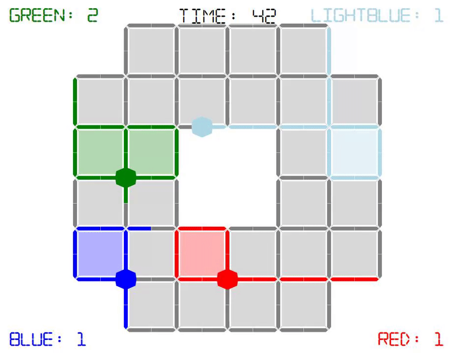

<!-- unlv-museum-banner-start -->
<a href="https://unlv-museum.recanon.com/milestown" target="_blank" rel="noopener">
  <picture>
    <source media="(prefers-color-scheme: dark)" srcset="https://unlv-museum.recanon.com/github-banners/milestown?theme=dark&v=d2f664719b">
    
  </picture>
</a>

> This `museum-ready/original` branch is the host-compatible build of the [`original` branch](https://github.com/moefingers/UNLV-MilestO-W-N/tree/original) — [audit the diff](https://github.com/moefingers/UNLV-MilestO-W-N/compare/original...museum-ready%2Foriginal): hosting fixes only (dead URLs, Node LTS floor, pnpm), behavior byte-for-byte. [Open in museum →](https://unlv-museum.recanon.com/milestown)
<!-- unlv-museum-banner-end -->

# MilestO-W-N

Play with up to four people at once!

It's complicated in some ways, simple in others. I came up with the idea of dynamic map generation from matrices and decided to implement it by looping through each item in a loop of each rows. See [`assets/data/maps.json`](https://github.com/moefingers/UNLV-MilestO-W-N/blob/shepherd/assets/data/maps.json), there's some player spawn information since dynamically picking fair spawns on maps with varying levels of complexity would be too convoluted.

Now deployed on GitHub. \
[Play now!](https://moefingers.github.io/UNLV-MilestO-W-N/)